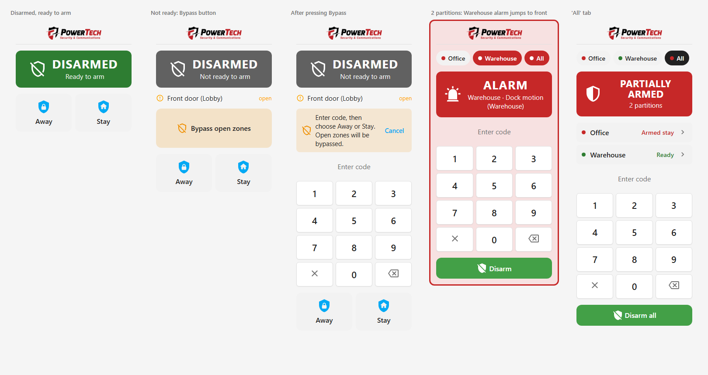
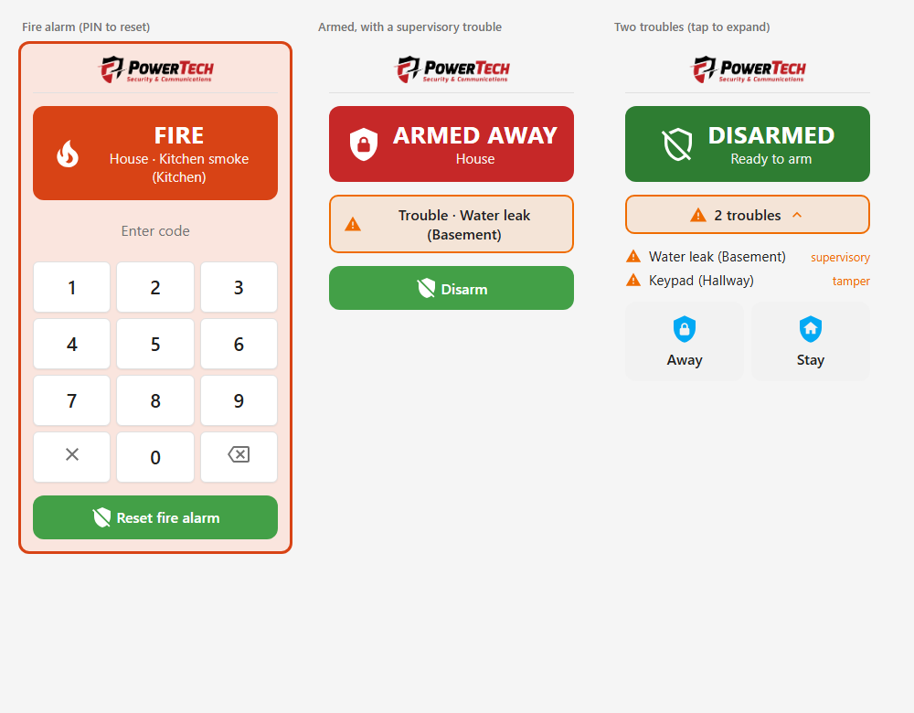

<p align="center">
  <a href="https://powertbs.com/"><picture>
    <source media="(prefers-color-scheme: dark)" srcset="docs/logo-dark.png">
    
  </picture></a>
  <br>
  <a href="https://powertbs.com/">powertbs.com</a>
</p>

# PT Alarm

[](https://contributors.home-assistant.io/marketplace/)
[](https://github.com/powertbs/pt-alarm/actions/workflows/validate.yaml)

**PT Alarm** by PowerTech Security & Communications turns the sensors you already have in Home Assistant into a professional-style alarm system. It has real zone types, partitions, user codes with schedules, troubles and a dashboard keypad. It runs entirely locally, with no cloud and no extra hardware.

<p align="center">
  <picture>
    <source media="(prefers-color-scheme: dark)" srcset="docs/card-overview-dark.png">
    
  </picture>
</p>

## Contents

- [Features](#features)
- [Requirements](#requirements)
- [Installation](#installation)
- [Setup](#setup)
- [General settings](#general-settings)
- [Zone types](#zone-types)
- [Arm modes and delays](#arm-modes-and-delays)
- [Partitions](#partitions)
- [Users and codes](#users-and-codes)
- [Bypassing zones](#bypassing-zones)
- [Automations and access control](#automations-and-access-control)
- [Fire, troubles and chime](#fire-troubles-and-chime)
- [Notifications](#notifications)
- [Sirens](#sirens)
- [Dashboard card](#dashboard-card)
- [Zone sensors](#zone-sensors)
- [Services](#services)
- [Events and activity log](#events-and-activity-log)
- [Panel attributes](#panel-attributes)
- [Restarts and power loss](#restarts-and-power-loss)
- [Troubleshooting](#troubleshooting)
- [Updating and removing](#updating-and-removing)
- [Changelog](#changelog)

## Features

- **Alarm-industry zone types:** Entry/Exit 1 and 2, Perimeter, Interior, Interior follower, Fire, 24-hour panic, Supervisory and Tamper.
- **Arm modes:** Away, Stay and Night (plus optional Vacation and Custom). Stay and Night leave motion zones off.
- **Two entry delays** per partition (for example front door 30 s, back door 45 s), an exit delay per mode, and an **Instant** option.
- **Partitions:** separate areas (for example *Office* and *Warehouse*), each with its own zones and arm state. One card can control them all.
- **User codes:** each user can have arm, disarm and bypass permissions, allowed days and hours, valid dates and holiday blocking, and access to one or more partitions. Codes are stored as salted hashes.
- **Ready / Not ready to arm**, with **bypass** of open zones. Bypassing needs an authorized PIN, and every disarm clears the bypasses.
- **Fire alarm** that sounds until it is reset with a PIN.
- **Troubles** (water leak, tamper, ...) that notify you but never sound the siren.
- **Door chime** on the dashboard while disarmed.
- **Automations and access control:** arm and disarm from schedules, UniFi Access, Hartmann or any automation. The log shows who did it and through which system.
- **Dashboard card:**
  - big colored status
  - keypad
  - countdown ring with beeps
  - partition tabs that jump to an alarm
  - bypass and trouble panels
- **Zone sensors** for every zone (Closed/Open, Clear/Motion, Bypassed, Alarm).
- **Activity log** that names the user ("disarmed by Owner", "FIRE ALARM: Kitchen smoke").
- **Email and push notifications** with an on/off switch for every event, and a branded HTML email that changes with each event.
- **Sirens** and **events** for automations.
- Restarts never resume a countdown or a siren, and an armed system stays armed.

## Requirements

- Home Assistant **2025.1** or newer (the Marketplace needs 2026.11 or newer).
- Sensors in Home Assistant for your doors, windows, motion, smoke and so on (`binary_sensor`, or `input_boolean` / `switch` for testing).
- Optional: an email notifier (for example SMTP), the Home Assistant phone app or an SMS notifier for notifications, and a siren, switch or light to sound during an alarm.

## Installation

### Home Assistant Marketplace (2026.11 and newer)

1. Go to **Settings → Marketplace**.
2. Search for **PT Alarm**. If it isn't in the catalog yet, choose **Add from link** and paste `https://github.com/powertbs/pt-alarm`. This needs a one-time GitHub connection.
3. Install it and restart Home Assistant when asked.
4. Add the integration as described in [Setup](#setup). The dashboard card is loaded automatically, so there is nothing to add under Resources.

### HACS (Home Assistant 2026.10 and older)

In HACS, open the menu ⋮ → **Custom repositories**, add `https://github.com/powertbs/pt-alarm` as an **Integration**, install it and restart Home Assistant.

### Manual

Copy `custom_components/pt_alarm` into your `config/custom_components/` folder and restart Home Assistant.

## Setup

1. Go to **Settings → Devices & services → Add integration → PT Alarm**.
2. Name the partition (for example *House* or *Office*) and, optionally, set a first user code.
3. Pick your sensors. For each sensor you get one screen to set:
   - **Name:** a short name such as "Front door".
   - **Zone type:** how the zone behaves. It is guessed for you.
   - **Device:** door, window, motion, smoke and so on, which sets the icon and the wording.
   - **Location:** an area, used in notifications ("Front door in Hallway").
   - **Chime:** whether to chime when the zone opens while disarmed.
4. To change anything later, open the integration and click **Configure**. Every change is saved when you click **Submit**. Clicking **Submit** without changing anything takes you back to the menu.

| Menu item | What you set there |
|---|---|
| General settings and entry delays | Entry delay 1 and 2, code requirements, auto-bypass, lockout |
| Arm modes | Enable each mode, plus its exit delay, siren time and Instant option |
| Add / Edit / Remove sensors | Name, zone type, device, location, chime |
| Add / Edit / Remove users | Code, permissions, schedule, dates, holidays, partitions, access IDs |
| Automations and access control | Allow automations, what to do with open zones, trust access control |
| Notifications (email, push and SMS) | Email and push/SMS notifiers, and which events each one sends |
| Send a test notification | Checks your email and phone setup |
| Sirens | Sirens, switches, lights or scripts to turn on during an alarm |

## General settings

**Configure → General settings and entry delays** (per partition):

| Setting | Default | Meaning |
|---|---|---|
| Entry delay 1 | 30 s | Time to disarm after an Entry/Exit 1 zone opens |
| Entry delay 2 | 45 s | Time to disarm after an Entry/Exit 2 zone opens |
| Code required to arm | Off | Off means anyone can arm from the card without a code |
| Code required to disarm | On | Turn off only for testing. A fire alarm always needs a PIN to reset |
| Disarm after the siren time | Off | When the siren time ends, disarm instead of going back to armed |
| Auto-bypass open zones | Off | Arm anyway and bypass the zones that are open (no PIN asked) |
| Wrong codes before lockout | 5 | After this many wrong codes in a row the keypad locks (0 = never) |
| Lockout time | 60 s | How long the keypad stays locked |

Default arm mode timings (change them under **Arm modes**):

| Mode | Exit delay | Siren time | Enabled |
|---|---|---|---|
| Away | 60 s | 300 s | Yes |
| Stay | 0 s | 180 s | Yes |
| Night | 0 s | 180 s | Yes |
| Vacation | 60 s | 300 s | No |
| Custom | 0 s | 180 s | No |

## Zone types

| Zone type | Typical use | Away | Stay / Night | Disarmed |
|---|---|---|---|---|
| **Entry/Exit 1** | Front door | Entry delay 1 | Entry delay 1 | – |
| **Entry/Exit 2** | Back or garage door | Entry delay 2 | Entry delay 2 | – |
| **Perimeter** | Windows, doors not used to enter | Instant alarm | Instant alarm | – |
| **Interior follower** | Motion next to an entry door | Follows a running entry delay, otherwise instant | Off | – |
| **Interior** | Other motion sensors | Instant alarm (even during an entry delay) | Off | – |
| **Fire / CO** | Smoke, heat, CO, gas | **Fire alarm** | **Fire alarm** | **Fire alarm** |
| **24-hour panic** | Panic buttons | Alarm | Alarm | Alarm |
| **Supervisory** | Water leak, freeze | Trouble only | Trouble only | Trouble only |
| **Tamper** | Device tamper switches | Trouble only | Trouble only | Trouble only |

- **Ready to arm:** open Entry/Exit and Perimeter zones make the partition *Not ready to arm*. Open motion zones do not.
- **End of the exit delay:** a zone that is still open is treated as if it had just opened.
- **Existing setups:** sensors you set up before zone types existed are converted automatically. Doors become Entry/Exit 1, windows Perimeter, motions Interior follower, smoke/heat/CO Fire, water/cold Supervisory and tamper Tamper.

## Arm modes and delays

| Mode | Zones armed |
|---|---|
| **Away** | All burglary zones |
| **Stay** | Entry/Exit and Perimeter. Motion zones are off |
| **Night** | Like Stay. Turn on **Instant** to remove the entry delay |
| **Vacation** (optional) | Like Away |
| **Custom** (optional) | Like Away |

- **Per partition:** Entry delay 1 and Entry delay 2.
- **Per mode:** exit delay, trigger (siren) time (0 means until disarmed), and **Instant**, which means no entry delay in that mode.

## Partitions

Each PT Alarm panel is a partition. To add another one, open the PT Alarm integration page and click **Add hub**. Each partition has its own zones, delays, arm state and zone sensors.

- **Users** can be given access to one or several partitions. The same user and code are kept in sync in each partition you choose.
- **The card** can show several partitions as tabs, plus an **All** tab that arms or disarms all of them at once. If a partition you are not looking at goes into alarm or entry delay, the card jumps to it and its tab flashes.

## Users and codes

Each user has:

| Setting | Meaning |
|---|---|
| Code | At least 4 characters. Digits only gives a numeric keypad. Stored hashed. |
| Can arm / Can disarm / Can bypass | Permissions |
| Allowed days and hours | For example Monday 08:00–16:00. Overnight windows like 22:00–06:00 work |
| Valid from / until | Optional dates, for guest or contractor codes |
| Not allowed while | Holiday calendars, Yom Tov sensors or a vacation switch. The code is refused while any of them is on |
| Partitions | Which partitions the code works in |

**Example:** a cleaner's code that works only on Mondays from 08:00 to 16:00, and not on holidays.

After too many wrong codes the keypad locks for a while (configurable).

## Bypassing zones

When a partition is *Not ready to arm*, the card lists the open zones and shows **Bypass open zones**. Enter a PIN of a user with bypass permission, then choose Away or Stay. Users without permission get "Sorry, you don't have permission to bypass."

- While armed, the card always shows **"N zones bypassed"**. Tap it to see which zones they are.
- **Every disarm clears all bypasses.** To arm past an open zone again, you have to bypass again.
- Fire, supervisory and tamper zones never need bypassing.

## Automations and access control

Automations, schedules and access control systems can arm and disarm a partition with the **`pt_alarm.arm`** and **`pt_alarm.disarm`** actions. The installer answers three questions during setup, which can be changed later under **Configure → Automations and access control**:

| Setting | Options |
|---|---|
| Allow arming and disarming by automations | Off (default): only the keypad with a code |
| When an automation arms while zones are open | **Refuse and notify**, or **Bypass the open zones, arm, and notify** |
| Trust access control | Allow a disarm even if the person is not a PT user |

Rules:

- **Never during an alarm.** A badge or automation cannot disarm while the alarm is sounding; someone has to go to the keypad. During the entry delay a badge *can* disarm.
- **The name is always used when it is known.** Pass the person in `user`, either a PT user name or one of the user's **Access IDs** (set them on the user, for example their UniFi Access name or card number).
- **PT users keep their rules.** If the name matches a PT user, that user's permissions, schedule, holidays and partitions apply.
- **Trust access control.** With this on, people who are not PT users (or no name at all) are accepted, because the access system already decided they may enter. Their name is still logged if it is sent.
- **The log always says what did it.** The automation or script name is detected automatically, or you can write your own text in `source`.

Example: disarm when someone badges in. Use your access system's event and the field that holds the person's name.

```yaml
triggers:
  - trigger: event
    event_type: your_access_control_event   # e.g. from UniFi Access or Hartmann
actions:
  - action: pt_alarm.disarm
    target:
      entity_id: alarm_control_panel.office
    data:
      user: "{{ trigger.event.data.user }}"
      source: "UniFi Access (Front door)"
```

Activity log examples:

- *disarmed by John via UniFi Access (Front door)*
- *armed away by automation "Closing time" (bypassed: Back door)*
- *refused disarm by Cleaner via UniFi Access: outside the allowed time*
- *refused disarm by John via UniFi Access: not allowed during an alarm*

The standard `alarm_control_panel` actions keep following the keypad rules, which means a code is needed when one is required. Use `pt_alarm.arm` and `pt_alarm.disarm` for automations.

## Fire, troubles and chime

<p align="center"></p>

- **Fire:** a fire zone triggers a **FIRE** alarm in every state, armed or not. It takes priority over a burglary alarm and sounds until it is reset with a PIN, even if disarming normally needs no code.
- **Troubles:** supervisory and tamper zones never sound the siren. They show a **Trouble** banner on the card, send a notification and appear in the activity log. The trouble clears by itself when the sensor returns to normal.
- **Chime:** zones with chime enabled play a two-tone chime on the dashboard card when they open while the partition is disarmed.

## Notifications

PT Alarm sends notifications through the notify services you already have in Home Assistant. You choose them in **Configure → Notifications**. PT Alarm doesn't set up email itself: add an email notifier first (for example **SMTP**), then pick it here. Notifiers set up in YAML (old-style `notify.*` services) get the HTML email. Notifiers set up from the UI (notify entities) get a plain-text email, because Home Assistant's `notify.send_message` only accepts a title and a message.

| Channel | What it does |
|---|---|
| **Email** | Branded HTML email (or plain text) to one or more email notify services |
| **Push / SMS** | Phones (for example `notify.mobile_app_my_phone`), SMS (for example `notify.twilio_sms`) or any other notifier. Alarm and fire pushes break through quiet modes |

Each channel has its own list of events to turn on or off:

| Event | Default email | Default push / SMS |
|---|---|---|
| Alarm (burglary / panic) | ✅ | ✅ |
| Fire alarm | ✅ | ✅ |
| Arming, Armed, Disarmed | – | – |
| Entry delay started | – | ✅ |
| Armed with bypassed zones | ✅ | – |
| Failed to arm (zones open) | ✅ | ✅ |
| Wrong code entered | ✅ | – |
| Keypad locked out | ✅ | ✅ |
| Trouble (tamper / supervisory) | ✅ | ✅ |
| Trouble restored | – | – |
| Arm/disarm refused (automation / access control) | ✅ | ✅ |

Use **Configure → Send a test notification** to check your setup.

### The HTML email

The email has the PowerTech logo, a colored status banner that changes with the event (red ALARM, green DISARMED, orange TROUBLE, and so on), the details (partition, zone and location, user, "via" system, bypassed zones, time), an **Open Home Assistant** button and a powertbs.com footer.

**Your own design:** copy `custom_components/pt_alarm/email_template.html` to your Home Assistant config folder as **`pt_alarm_email.html`** and edit it. PT Alarm uses your file automatically. Placeholders you can use:

| Placeholder | Content |
|---|---|
| `$title` / `$subtitle` | Banner text, e.g. "Alarm" / "Office · The alarm is sounding" |
| `$message` | The full sentence, e.g. "ALARM! Office was triggered by Back door in Warehouse" |
| `$color` / `$icon` | Banner color and icon for the event |
| `$rows` | The details table rows |
| `$partition`, `$time`, `$year` | As named |
| `$button` | The "Open Home Assistant" button (empty if no URL is set) |
| `$logo_url`, `$subject`, `$preheader` | Logo image, email subject, preview text |

## Sirens

Under **Configure → Sirens**, pick the sirens, switches, lights or scripts to turn on when the alarm sounds. They are turned on with `homeassistant.turn_on` when the alarm starts, and turned off when the partition is disarmed or the siren time of the arm mode ends. For more control (strobes, different sounds for fire, announcements on speakers), use the `pt_alarm_event` events in your own automations. See [Events and activity log](#events-and-activity-log).

## Dashboard card

The card is loaded automatically and appears in the card picker as **PT Alarm Card**, with a visual editor.

```yaml
type: custom:pt-alarm-card
entity: alarm_control_panel.office       # default partition
entities:                                # optional: more partitions, shown as tabs
  - alarm_control_panel.warehouse
show_all: true          # 'All' tab to arm or disarm every partition
name: House             # optional (single partition only)
modes:                  # optional: arm buttons to show (default: all enabled modes)
  - armed_away
  - armed_home
show_keypad: true
show_sensors: true      # list open zones
show_logo: true         # PowerTech logo (follows light/dark theme)
status_style: bar       # bar (colored status bar) or card (whole card colored)
keypad_style: modern    # modern (square keys) or round
sound: true             # beeps during delays, door chime
```

What the card shows:

| State | Display |
|---|---|
| Disarmed | Green bar **DISARMED · Ready to arm**, or grey bar **Not ready to arm** with the open zones and **Bypass open zones** |
| Arming / Entry delay | Amber bar and a ring around the PT shield that shrinks every second (blue for exit, orange for entry). One beep per second, faster in the last 10 seconds |
| Armed | Red bar **ARMED AWAY / ARMED STAY**, plus **"N zones bypassed"** if any |
| Alarm | The whole card turns red and flashes. **FIRE** has its own color and a **Reset fire alarm** button |
| Trouble | An orange **Trouble · Water leak (Basement)** banner in any state |

Browsers only play sound after the page has been touched, so a wall tablet must be tapped once after it loads.

## Zone sensors

Each zone gets a status sensor on the partition's device, for example `sensor.office_front_door`. The words depend on the device:

| Device | Normal | Active |
|---|---|---|
| Door, window, other | `closed` | `open` |
| Motion | `clear` | `motion` |
| Tamper | `ok` | `tampered` |
| Smoke / CO / water | `clear` | `detected` |

Every zone can also be `bypassed` or `alarm` (this zone caused the current entry delay or alarm).

Attributes:
- `entity_id`: the source sensor
- `location`
- `device_kind`
- `zone_type`
- `armed_in_away`
- `armed_in_stay`
- `trouble_zone`
- `chime`
- `is_open`
- `bypassed`

`sensor.<partition>_open_zones` counts the open zones.

## Services

All standard `alarm_control_panel` actions work (`alarm_arm_away`, `alarm_arm_home`, `alarm_disarm`, `alarm_trigger`, ...). PT Alarm adds:

### `pt_alarm.arm`

| Field | Description |
|---|---|
| `mode` | `away`, `stay`, `night`, `vacation` or `custom_bypass` |
| `code` | User code (if required) |
| `force` | Bypass open zones (needs a user with bypass permission) |
| `skip_delay` | Arm right away, without the exit delay |
| `user` | For automations: PT user name or access ID |
| `source` | For automations: text for the log (defaults to the automation's name) |

### `pt_alarm.disarm`

| Field | Description |
|---|---|
| `code` | User code (keypad style) |
| `user` | For automations: PT user name or access ID |
| `source` | For automations: text for the log (defaults to the automation's name) |

```yaml
action: pt_alarm.arm
target:
  entity_id: alarm_control_panel.office
data:
  mode: stay
  code: "1234"
```

## Events and activity log

Everything fires a `pt_alarm_event`. The Home Assistant activity log shows readable entries that name the user, for example:

- *armed stay by Owner*
- *disarmed by Cleaner*
- *ALARM triggered by Back door in Garage*
- *FIRE ALARM: Kitchen smoke in Kitchen*
- *fire alarm reset by Owner*
- *TROUBLE (Supervisory): Water leak in Basement*
- *code of Cleaner refused, outside its allowed time*

Event types:
- `arming`, `armed`, `disarmed`
- `pending`, `triggered`
- `failed_to_arm`, `invalid_code`, `locked_out`
- `trouble`, `trouble_restored`
- `chime`
- `access_denied`

`triggered` events include `alarm_type` (`burglary`, `fire` or `panic`).

Example automation, which turns on the lights when a fire alarm starts:

```yaml
triggers:
  - trigger: event
    event_type: pt_alarm_event
    event_data:
      event: triggered
      alarm_type: fire
actions:
  - action: light.turn_on
    target:
      area_id: hallway
```

## Panel attributes

| Attribute | Meaning |
|---|---|
| `arm_mode` | Current or target armed mode |
| `alarm_type` | `burglary`, `fire` or `panic` while triggered |
| `ready_to_arm` / `not_ready_sensors` | Whether the partition can be armed without bypassing |
| `open_sensors` / `bypassed_sensors` | Open zones / zones bypassed for this arming |
| `troubles` | Active troubles (name, zone type, location, since) |
| `delay` / `expiration` | Running exit or entry countdown |
| `triggered_by` | Zone that caused the entry delay or alarm |
| `last_chime` | Last chime (used by the card) |
| `zones` | Name, device, zone type and location of every zone |
| `locked_until` | End of the keypad lockout |
| `changed_by` | User who last armed or disarmed |

## Restarts and power loss

- An **armed** partition stays armed after a Home Assistant restart.
- A running **exit or entry delay** or a sounding **siren** is never resumed after a restart. The partition goes back to its armed mode, and a zone that is still open is handled normally from there.
- A **disarmed** partition stays disarmed.
- Sensors that are `unavailable` or `unknown` are not counted as open.

## Troubleshooting

| Problem | What to check |
|---|---|
| The card is not in the card picker | Refresh the browser (on phones, clear the app cache under **Settings → Companion app → Debugging**). Make sure the integration is set up at least once |
| No beeps or chime | Browsers only play sound after the page has been touched. Tap the card once after loading. Check that `sound` is not set to `false` |
| No email arrives | Run **Configure → Send a test notification**. Check that the right notifier is picked under **Email**, and look in **Settings → System → Logs** for "PT Alarm could not notify" |
| Email arrives without the design | The notifier is a notify entity (set up from the UI). Those only accept plain text. Use a YAML `notify` platform (for example SMTP) to get the HTML email |
| No logo in the email | The logo loads from GitHub. Some email apps hide images until you allow them |
| "Not ready to arm" but everything looks closed | The card lists the open zones. Check that sensor in **Developer tools → States** |
| A code is refused | Check the user's permissions, allowed days and hours, valid dates, holiday entities and partitions. The activity log says why it was refused |
| An automation can't disarm | Turn on **Allow arming and disarming by automations**. Disarming is never allowed by an automation during an alarm |
| The keypad is locked | Wait for the lockout time to end (shown on the card) |

To see more detail, add this to `configuration.yaml`:

```yaml
logger:
  logs:
    custom_components.pt_alarm: debug
```

You can also download **diagnostics** from the integration page (⋮ → Download diagnostics). Codes are never included.

## Updating and removing

- **Update:** the Marketplace (or HACS) shows a new version when it is released. Install it and restart Home Assistant. Your settings, users and zones are kept.
- **Remove:** delete each PT Alarm partition under **Settings → Devices & services → PT Alarm**, then uninstall it from the Marketplace and remove the card from your dashboards.

## Changelog

See the [releases page](https://github.com/powertbs/pt-alarm/releases) and [CHANGELOG.md](CHANGELOG.md).

## Development

```bash
pip install -r requirements_test.txt
pytest
```

## About PowerTech

PT Alarm is made by **[PowerTech Security & Communications](https://powertbs.com/)**. Learn more at [powertbs.com](https://powertbs.com/).

Found a bug or have a feature request? [Open an issue](https://github.com/powertbs/pt-alarm/issues).

## Credits

Inspired by [Alarmo](https://github.com/nielsfaber/alarmo) by Niels Faber. PT Alarm is an independent implementation.

## License

MIT
